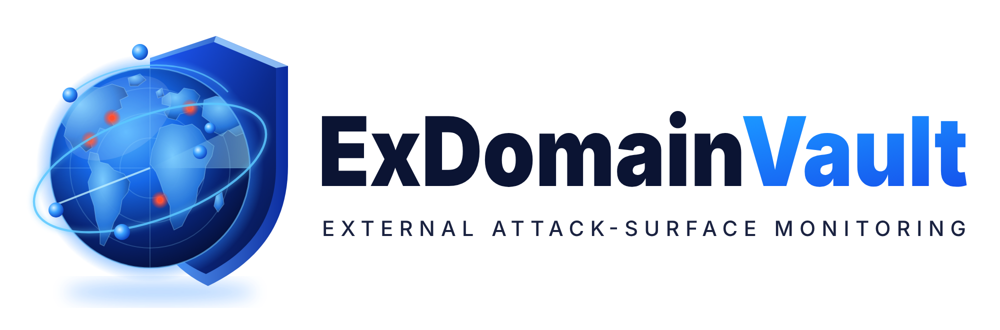

<p align="center"></p>

# ExDomainVault

**External Domain Security & Exposure Monitoring** — evidence-backed, authorised and explainable
monitoring of an organisation's internet-facing domains.

> **Status:** Milestones 1–11 are complete and deployed at
> https://exdomainvault.amrin78.workers.dev (behind Cloudflare Access). Milestone 12 (production
> hardening) is in progress. See [`docs/progress.md`](docs/progress.md).

## Features

- **Domain inventory** — add or CSV-import registrable domains (IDN-aware, PSL-validated), owner and
  criticality, monitoring on/off in bulk.
- **Authorisation** — DNS TXT verification or audited administrator authorisation with a review date.
  It gates **active** scanning only; passive monitoring is allowed for every domain.
- **Passive monitoring** — DNS (incl. DNSSEC, CAA, SPF/DMARC), RDAP registration data, and Certificate
  Transparency subdomain discovery (crt.sh). Discovered names become `pending` assets that an
  administrator approves before they enter scan scope; third-party hosting is labelled.
- **Active checks** (both server and worker switches on, verified domains only) — TLS certificate and
  HTTP checks on approved hostnames; TCP port and service identification (Nmap connect scans) only in
  administrator-approved networks. Profiles: passive, quick, standard, deep; optional schedules.
- **Deterministic rules engine** — 25 versioned rules ([`docs/advisory-rules.md`](docs/advisory-rules.md)),
  severity from rules only, a separate risk score with stored inputs.
- **Finding lifecycle** — stable fingerprints, triage, remediation, accepted risk with review dates,
  comments, re-checks, recurrence reopens the same finding; only a successful scan resolves.
- **Exposed software** — product/version inventory from existing evidence, end-of-life (endoflife.date)
  and known-exploited-vulnerability matching (CISA KEV + NVD), reported as "possibly affected — verify".
- **Reports and audit** — portfolio summary, trends, expiring registrations/certificates, CSV export,
  full audit log of privileged actions, user administration with four roles.
- **Operations** — system health (worker liveness, queue, scan success/duration, feeds, retention),
  outage alert banner and log line, retention, per-user rate limits and scan quotas.

## Architecture

```text
                    ┌───────────────────────── Cloudflare ──────────────────────────┐
 Browser ─(Access)─▶│ Worker "exdomainvault"                                         │
                    │  ├─ React SPA (static assets)                                  │
                    │  ├─ /api/v1/* → Hono API (authN/Z, validation, audit)          │
                    │  ├─ Cron */5 → maintenance: leases, schedulers, rules,         │
                    │  │             feeds, outage check, retention                  │
                    │  └─ HYPERDRIVE (pg + Drizzle) ─────────────────────────────────┼─▶ Neon PostgreSQL
                    └───────────────────────────────▲────────────────────────────────┘   (source of truth)
                                                    │ outbound HTTPS only, polling:
                                                    │ Access service token + Ed25519-signed
                                                    │ claim / heartbeat / results / failures
                                   Home scan host: Python worker (systemd, sandboxed, Nmap)
                                                    │
                                                    ▼ only approved, validated targets
                                       Internet: DNS, RDAP, crt.sh, target web/TLS/ports
```

| Part             | Location            | Technology                                             |
| ---------------- | ------------------- | ------------------------------------------------------ |
| Web UI           | `apps/web/src`      | React 19, Vite 8, TypeScript (strict), Tailwind 4      |
| API              | `apps/web/worker`   | Cloudflare Worker (Hono) serving `/api/v1` and the SPA |
| Shared contracts | `packages/shared`   | zod schemas and types used by both API and UI          |
| Database         | `packages/database` | Neon PostgreSQL + Drizzle, versioned SQL migrations    |
| Rules engine     | `packages/rules`    | Pure, deterministic, versioned rules                   |
| Scanning worker  | `worker/`           | Python 3.12 on a home Linux host, pull-based, systemd  |

Details: [`docs/architecture.md`](docs/architecture.md). Product specification: [`docs/design.md`](docs/design.md).

## Security model

- **Authentication fails closed.** Cloudflare Access fronts every request; the Worker verifies the
  Access JWT itself (JWKS, issuer, audience, expiry). Unconfigured auth → `503`. A separate dev sign-in
  exists only for local development and is refused in production.
- **Server-side authorisation** per role (admin, analyst, asset_owner, viewer) on every route; asset
  owners see only their assets. CSRF: same-origin check on every unsafe method. Rate limits per user.
- **Scan safety.** No exploits, brute forcing or destructive tests. Scanner arguments come only from
  server-defined profiles (argument lists, never a shell). A scope validator enforces exact DNS label
  boundaries, rejects private/reserved/loopback/CGNAT/documentation ranges (incl. IPv4-mapped IPv6),
  pins and re-validates each address, re-checks every redirect and CNAME hop, and logs each decision.
  CT discoveries stay `pending` until approved; the worker also denies its own home addresses.
  Details: [`docs/scan-safety.md`](docs/scan-safety.md).
- **Worker trust.** Two independent gates: an Access service token and an Ed25519 request signature
  (timestamp window, single-use nonces, revocable expiring keys). The database stores only public keys.
- **Data integrity.** PostgreSQL is the source of job state; atomic claims with leases, heartbeats and
  bounded retries; idempotent result ingestion. Failed or incomplete scans never resolve findings.
- **Least privilege.** The app connects as `exdomainvault_app` (no DDL; audit log, finding history and
  comments append-only). Secrets live only in Cloudflare, Hyperdrive and the scan host — never in git.
- **Supply chain.** CI runs `npm audit`, `pip-audit` and gitleaks, checks lockfile drift, pins actions
  to commit SHAs; Dependabot with a 14-day cooldown.

Threat model: [`docs/threat-model.md`](docs/threat-model.md).

## Quick start (development)

Prerequisites: Node.js 22.12+ (24 recommended, `.nvmrc`) and npm 11; Python 3.12+ with `venv`
(Ubuntu: `sudo apt install python3.12-venv`) for the worker; the `neon` CLI for the database.

```bash
git clone https://github.com/amrin78-smb/ExDomVault.git
cd ExDomVault
npm ci

# Local Worker variables (git-ignored): dev sign-in as dev@example.com (admin)
cp apps/web/.dev.vars.example apps/web/.dev.vars

# Database: a Neon dev branch, credentials in .env.local (git-ignored), then migrate it
npm i -g neon
neon checkout dev --create
npm run db:migrate

npm run dev        # http://localhost:5173 — UI and /api/v1 in the local Workers runtime
```

`curl http://localhost:5173/api/v1/health` should report `database: ok` and `auth: ok`.
The dev branch expires after 7 days; recreate it with `neon checkout dev --create && npm run db:migrate`.

Optional synthetic data for layout work: `VITE_DEV_FIXTURES=true` in `apps/web/.env.development.local`.
Pages then show a yellow "Development data" banner; fixtures are stripped from production builds.

Worker locally: `npm run worker:install`, copy `worker/.env.example` to `worker/.env`, then
`worker/.venv/bin/exdomainvault-worker --check-config` / `--once`
([`docs/worker-protocol.md`](docs/worker-protocol.md)).

## Quality checks

```bash
npm run lint        # ESLint + Prettier (npm run format to fix)
npm run typecheck   # TypeScript across all workspaces
npm test            # Vitest (UI, Worker API on PGlite, shared, database) — max 2 workers
npm run build       # Production build into apps/web/dist
npm run db:check    # Migration consistency

npm run worker:install && npm run worker:lint && npm run worker:test   # Python worker

npm run audit:npm      # npm audit (prod: high+, all: critical)
npm run worker:audit   # pip-audit on worker requirements (needs network)
```

CI (`.github/workflows/ci.yml`, `security.yml`) runs these on every push and pull request, and the
security checks weekly. CI never deploys.

## Configuration

| File                                            | Purpose                                                                   | Committed |
| ----------------------------------------------- | ------------------------------------------------------------------------- | --------- |
| `apps/web/wrangler.jsonc`                       | Worker config and non-secret vars (Access ids, `ACTIVE_SCANNING_ENABLED`) | yes       |
| `apps/web/.dev.vars`                            | Local Worker variables (from `.dev.vars.example`)                         | **no**    |
| `.env.local`                                    | Neon connection strings for the checked-out branch (`neon` CLI)           | **no**    |
| `.neon`                                         | Linked Neon project and checked-out branch                                | **no**    |
| `apps/web/.env.development.local`               | Vite build-time flags                                                     | **no**    |
| `worker/.env` / `/etc/exdomainvault/worker.env` | Worker settings (from `worker/.env.example`)                              | **no**    |

Production secrets are set with `wrangler secret put` and never placed in `wrangler.jsonc` or `VITE_*`.

## Documentation

| Topic                                   | Document                                                 |
| --------------------------------------- | -------------------------------------------------------- |
| Product specification                   | [`docs/design.md`](docs/design.md)                       |
| Build progress, decisions, limitations  | [`docs/progress.md`](docs/progress.md)                   |
| Architecture                            | [`docs/architecture.md`](docs/architecture.md)           |
| Threat model                            | [`docs/threat-model.md`](docs/threat-model.md)           |
| Database schema                         | [`docs/database-schema.md`](docs/database-schema.md)     |
| API specification                       | [`docs/api-specification.md`](docs/api-specification.md) |
| Worker protocol                         | [`docs/worker-protocol.md`](docs/worker-protocol.md)     |
| Scan safety and scope validation        | [`docs/scan-safety.md`](docs/scan-safety.md)             |
| Advisory rules (generated)              | [`docs/advisory-rules.md`](docs/advisory-rules.md)       |
| Deployment, rollback, secrets           | [`docs/deployment.md`](docs/deployment.md)               |
| Home worker setup (scan host)           | [`docs/home-worker-setup.md`](docs/home-worker-setup.md) |
| Operations, alerts, retention, patching | [`docs/operations.md`](docs/operations.md)               |
| Backup, restore, RPO/RTO                | [`docs/backup-restore.md`](docs/backup-restore.md)       |
| Troubleshooting                         | [`docs/troubleshooting.md`](docs/troubleshooting.md)     |

## Deployment

Owner action only; nothing deploys automatically. Procedure, checklist and rollback:
[`docs/deployment.md`](docs/deployment.md).
