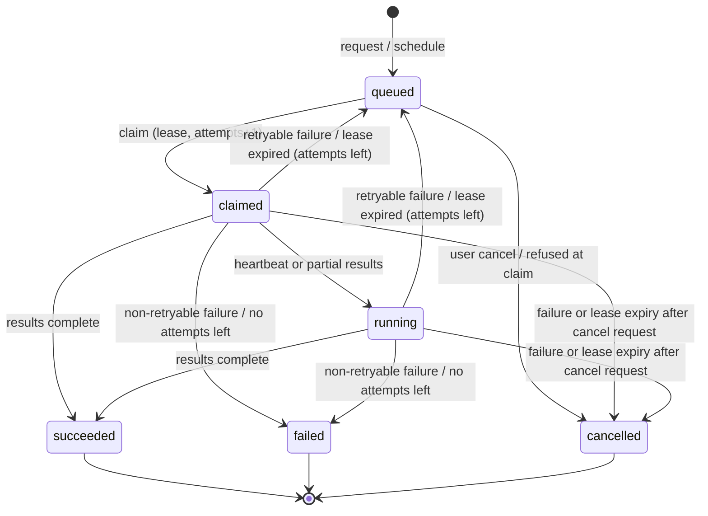

# Architecture

Describes what is implemented. Planned components are marked _(planned, Milestone N)_.

## Overview

```text
                     ┌──────────────────────── Cloudflare ─────────────────────────┐
 Browser ─(Access)─▶ │  Worker "exdomainvault"                                      │
                     │   ├─ static assets: React SPA (apps/web/src → dist/client)   │
                     │   └─ /api/v1/*  → Hono app (apps/web/worker)                 │
                     │        ├─ Cron Trigger */5: maintenance (no Queues)          │
                     │        └─ HYPERDRIVE binding (pg + Drizzle) ─────────────────┼──▶ Neon PostgreSQL
                     └──────────────────────────────▲───────────────────────────────┘
                                                    │ outbound HTTPS only
                                                    │ signed: claim / heartbeat /
                                                    │ results / failures (polling)
                                  Home Linux worker (Python, systemd)  (planned, M5–6)
```

- **One Worker** serves both the SPA and the API via Cloudflare's Vite plugin. `wrangler.jsonc` sets
  `run_worker_first: ["/api/*"]` so API paths always reach the Worker, and SPA fallback for client routes.
- **The frontend never talks to the database.** It calls `/api/v1` and validates every response with the
  zod schemas in `packages/shared`.
- **The home worker initiates all connections** (pull model). No inbound ports at home.

## API layer (`apps/web/worker`)

Request pipeline (`app.ts`):

1. `requestContext` — server-generated UUID request ID (client values ignored), request-scoped JSON
   logger, one access log line per request. ID returned in `X-Request-Id`.
2. `securityHeaders` — `nosniff`, `no-referrer`, `DENY` framing, `no-store`, HSTS.
3. `configMiddleware` — validates bindings with zod (`APP_ENV`, `APP_VERSION`, auth settings). Invalid
   configuration throws → generic 500 (fail closed).
4. `database` — `c.var.db()` lazily opens one node-postgres connection per request through the
   `HYPERDRIVE` binding and closes it after the response (`waitUntil`). Connection failures → 503.
5. Public routes: `/health`.
6. Everything else: `sameOriginWrites` (CSRF: unsafe methods need a same-origin `Origin`) → `requireAuth`
   (configured `AuthProvider`, then identity → active user) → route, which adds `requirePermission(...)`.
7. `handleNotFound` / `handleError` — standard error envelope; unknown errors are logged with stack
   server-side and returned as a generic `internal_error`.

Endpoints: `GET /health` (public), `GET /me`, domains (`routes/domains.ts`: list, create, detail, update,
DNS TXT verification, administrator authorisation, CSV import, scan request), scan profiles and scans
(`routes/scans.ts`), worker administration (`routes/workers.ts`) and the signed internal worker API
(`routes/internal-worker.ts`, mounted outside the user-authenticated sub-app). Full contract:
[`api-specification.md`](api-specification.md).

Request bodies and query strings are validated with the shared zod schemas (`lib/validation.ts`: JSON
content type and a body limit in bytes enforced — 300 KB for user requests, 1 MB for the signed worker API; malformed UUID params → 404).

## Domain inventory

- **Normalisation** (`packages/shared/src/hostname/normalise.ts`, subpath export
  `@exdomainvault/shared/hostname`, server-only because it bundles the Public Suffix List): ASCII
  pre-filter → WHATWG URL IDNA → strict LDH/A-label checks → PSL registrable-domain boundary (`tldts`,
  ICANN section only). `isWithinDomain()` is the exact label-boundary check later reused for scope.
- **Verification** (`services/domain-verification.ts`): random 256-bit token, SHA-256 stored, 72 h
  expiry, superseding, atomic 10 s check throttle, lookup through DoH (`lib/doh.ts`) from the Worker.
  Chosen over a home-worker job because it is a single passive query to a public resolver, needs no
  scanning infrastructure (Milestone 5) and gives immediate feedback. Expiry is applied lazily on reads
  and writes, and also by the maintenance Cron Trigger.
- **Administrator authorisation** (`services/domain-authorisation.ts`): the second verification
  method, for owned domains whose DNS cannot be edited. Reason, reference and review date (≤ 24 months)
  are stored on the verification record and audited per domain; it lapses on the review date (lazily
  and by the Cron Trigger, like challenge expiry). Bulk operations are set-based. Verification of either kind gates only active
  scanning; passive monitoring is allowed for every domain.
- **Import** (`services/domain-import.ts`, `lib/csv.ts`): stateless two-step preview/confirm bound by a
  SHA-256 digest of the file; confirm re-validates and inserts valid rows in one transaction.
- Every change writes its audit record in the same transaction (`domain.*` actions).

## Authentication and authorisation

- `worker/auth/types.ts` — the replaceable `AuthProvider` interface (`authenticate(request) → identity`).
- `worker/auth/cloudflare-access.ts` — production. Verifies the Access JWT (header or `CF_Authorization`
  cookie) with jose: RS256 signature against the team JWKS (cached per isolate), issuer, audience, expiry.
  Plain identity headers are never trusted.
- `worker/auth/dev.ts` — local development. Fixed identity from `DEV_AUTH_EMAIL`; config loading refuses
  it when `APP_ENV=production`.
- `worker/services/users.ts` — maps identity → user: by provider subject, else bind a pre-provisioned email,
  else bootstrap an admin from `BOOTSTRAP_ADMIN_EMAILS` (audited), else 403.
- Roles and the permission matrix live in `packages/shared` so UI and API agree; enforcement is server-side.
- `worker/services/audit.ts` — `writeAudit()`; call inside the same transaction as the audited change.

## Database (`packages/database`)

Drizzle schema (`src/schema/`), generated SQL migrations (`migrations/`), `connect()` / `pingDatabase()`,
a guarded migration runner (`scripts/migrate.ts`: refuses the production branch and pooled URLs unless
explicitly allowed), and `src/testing.ts` (PGlite with migrations applied, tests only).
Details: [`database-schema.md`](database-schema.md). Neon/Hyperdrive setup: [`deployment.md`](deployment.md).

## Frontend (`apps/web/src`)

- `react-router` data router (`routes.tsx`), persistent `AppShell` (sidebar + top bar + outlet), route
  error boundary.
- Navigation: Overview, Domains, Assets, Scans, Findings, Advisories, Reports, Settings. Unbuilt sections
  render a placeholder naming their milestone.
- Domains: list (`/domains`, filters/sort/page in the URL), detail (`/domains/:id`: verification panel,
  owner/criticality, monitoring with confirmation, registration status, honest empty states for data not
  collected yet) and CSV import (`/domains/import`).
- Scans: list (`/scans`, status filter and page in the URL, `?domainId=` from a domain page) and
  detail (`/scans/:id`: job state, attempts, worker, lease, progress, last error, the frozen scope
  snapshot and per-target status; polls every 10 s while the job is queued/claimed/running; cancel
  button for `scans:request`). `ScanStatusBadge` deliberately does not use severity colours.
- Domain detail has a **Scans** card: profile picker (active profiles disabled with the reason — active
  scanning not enabled, or domain not verified), "Request scan" (navigates to the new job), and the five
  most recent jobs.
- Settings (`/settings`): **Scanning workers** for `settings:manage` — the `openssl` key-generation
  commands, a register form (name + base64 public key; shows the key id to configure on the worker),
  and per worker its status (enable/disable), last seen, version and credentials (key id, fingerprint,
  expiry, last used, revoke). Adding a rotation key is API-only for now. Other users see an
  "Administrators only" notice.
- `SessionProvider` loads `/api/v1/me` once; `usePermission()` hides actions the user's role cannot
  perform (the API still enforces every permission).
- The top bar shows API health (`/api/v1/health`) and the signed-in user and role (`/api/v1/me`), or why
  sign-in failed (not signed in / access not granted / sign-in unavailable).
- **Development fixtures** (`lib/fixtures/`, RFC 2606 names) render only when
  `import.meta.env.DEV && VITE_DEV_FIXTURES === 'true'`, always under a warning banner, and are removed from
  production bundles.

## Scan jobs and the worker protocol

Code: `services/scans.ts` (profiles, creation, reads, cancellation), `services/job-lifecycle.ts` (claim,
heartbeat, results, failures, reaper), `services/maintenance.ts` (Cron Trigger),
`middleware/worker-auth.ts` (request signatures), `lib/ed25519.ts`. PostgreSQL is the only source of job
state; every transition is a row update inside a transaction.

**Profiles.** Server-defined rows in `scan_profiles`, validated with `scanProfileConfigSchema` on every
read (invalid rows are ignored). A profile is _passive_ (`active: false`, only `dns` and `rdap` checks,
which query public resolvers and registries) or _active_ (contacts target hosts). The schema refuses a
non-passive check in a passive profile and ports without the `tcp_ports` check. Configs contain data
only, never scanner flags.

**Creation.** `POST /domains/:id/scans` locks the domain row, resolves approved targets, and inserts the
job, its `scan_job_targets` and an immutable `scope_snapshot` (domain authorisation state, profile key,
version and full config, targets) in one transaction. Active profiles require `ACTIVE_SCANNING_ENABLED`
and a domain that is verified with its review date (if any) in the future. The partial unique index
`scan_jobs_one_active_per_domain_profile` allows one queued/claimed/running job per domain and profile.

**States.**



| Mechanism          | Implementation                                                                                                                                                                                                                                                                                                                                                                                                                                                                                                                                                                                |
| ------------------ | --------------------------------------------------------------------------------------------------------------------------------------------------------------------------------------------------------------------------------------------------------------------------------------------------------------------------------------------------------------------------------------------------------------------------------------------------------------------------------------------------------------------------------------------------------------------------------------------- |
| Claim              | `SELECT … WHERE status='queued' AND scheduled_at <= now AND attempts < max_attempts [AND profile IN (…)] ORDER BY priority, scheduled_at LIMIT 1 FOR UPDATE SKIP LOCKED`, then `status=claimed`, `worker_id`, `attempts+1`, lease, `started_at` (first claim only).                                                                                                                                                                                                                                                                                                                           |
| Lease              | `LEASE_SECONDS = 300`, renewed by heartbeats and partial results. The worker is told `HEARTBEAT_SECONDS = 60`.                                                                                                                                                                                                                                                                                                                                                                                                                                                                                |
| Fencing            | The attempt number returned by claim. Heartbeats, results and failures lock the job row and are rejected (`409`) unless the job is `claimed`/`running`, held by the same worker, and `attempts` matches.                                                                                                                                                                                                                                                                                                                                                                                      |
| Idempotent results | `scan_job_results (scan_job_id, result_id)` unique; a duplicate `resultId` changes nothing. Reported targets must belong to the job.                                                                                                                                                                                                                                                                                                                                                                                                                                                          |
| Retry / backoff    | Retryable failure with attempts left → `queued`, `scheduled_at = now + min(60 s × 2^(attempt−1), 30 min)` (60 s, then 120 s with the default 3 attempts), `worker_id`/lease cleared, running targets back to `pending`. The last error stays visible.                                                                                                                                                                                                                                                                                                                                         |
| Max attempts       | `max_attempts` default 3 (check `attempts <= max_attempts`). After the last attempt the job is `failed`.                                                                                                                                                                                                                                                                                                                                                                                                                                                                                      |
| Reaper             | Up to 100 `claimed`/`running` jobs with `lease_expires_at <= now` per run (`FOR UPDATE SKIP LOCKED`) are treated as a retryable `lease_expired` failure.                                                                                                                                                                                                                                                                                                                                                                                                                                      |
| Cancellation       | Queued → `cancelled` at once. Claimed/running → `cancel_requested_at` set; heartbeat returns `cancelRequested: true`; the next failure report or lease expiry ends it as `cancelled` (targets `skipped`). A worker that instead reports completion ends it `succeeded`.                                                                                                                                                                                                                                                                                                                       |
| Re-authorisation   | At claim time an active-profile job is refused if `ACTIVE_SCANNING_ENABLED` is off, the domain is gone, or the domain is no longer verified (or its review date passed). Scheduled jobs are also refused if monitoring was turned off while they waited (`monitoring_disabled`). Refused jobs become `cancelled` with `error_code` `active_scanning_disabled` / `domain_missing` / `domain_not_authorised` / `monitoring_disabled` (or `invalid_snapshot` if the snapshot fails validation), their pending targets `skipped`, audited `scan.refused`. Manual passive jobs are not re-checked. |

**`ACTIVE_SCANNING_ENABLED`** (Worker var, `"false"` in `wrangler.jsonc`; only `"true"`/`"false"`
accepted, anything else fails configuration). While off, active jobs can neither be created (`409`) nor
claimed. It stays off until the Milestone 6 scope validator is complete.

**Scheduling and maintenance** (`scheduled()` in `worker/index.ts`, Cron Trigger `*/5 * * * *`). Each
run opens one connection through Hyperdrive and runs these independent steps; a failing step is logged
(`maintenance_step_failed`) and the others still run. All are safe to repeat or overlap.

1. Reap expired leases (above).
2. Expire stale DNS challenges and lapse admin authorisations past their review date.
3. Prune `worker_request_nonces` older than 600 s (twice the signature window).
4. Schedule passive monitoring: for up to **200** domains per run (by name) with `monitoring_enabled`
   and no passive job queued/claimed/running or created in the last **23 h**, insert a `passive` job with
   **priority 200** (behind user-requested jobs at 100), trigger `schedule`, targets = apex plus approved
   assets (≤ `maxTargets`). Set-based, `ON CONFLICT DO NOTHING` against the one-active-job index; one
   `scan.scheduled` audit entry per run. Verification is not required (passive). Profiles' other
   `default_schedule` values (`weekly`, `monthly`) are not scheduled yet.

**No Queues.** The design allowed Cloudflare Queues for dispatch; they are not used. The home worker
cannot receive pushes (no inbound connections), so it polls `claim`; the database claim is the dispatch
mechanism and the Cron Trigger covers timed work. This avoids a second, at-least-once delivery path that
would duplicate database state.

**Worker authentication.** The worker holds an Ed25519 private key; only the public key is registered
(Settings → Workers). Each request is signed over method, path, timestamp, nonce and body hash, checked
within ±300 s, rate limited (120/min per credential) and replay-protected by stored nonces. Details:
[`api-specification.md`](api-specification.md#internal-worker-api--signed-requests).

## Python worker (`worker/`)

Validated configuration (`app/config.py`) and a `--check-config` entry point. `active_scanning_enabled` is
hard-coded `False` until the Milestone 6 gate. The worker does not yet implement the claim/heartbeat/results
protocol (Milestone 5), so jobs stay `queued` until then.

## Testing

- Vitest projects: `web` (jsdom UI tests; API/service tests with `// @vitest-environment node`), `shared`,
  `database`.
- API and service tests run the Hono app in Node against **PGlite** (real PostgreSQL compiled to WASM) with
  all migrations applied, injected via `createApp({ connect })`. No network, no Neon.
- The real path (workerd + Hyperdrive local binding + Neon dev branch) is exercised with `npm run dev`.
- CI also fails if the Drizzle schema and committed migrations drift apart.
- pytest for the worker. Tests never contact real hosts.
